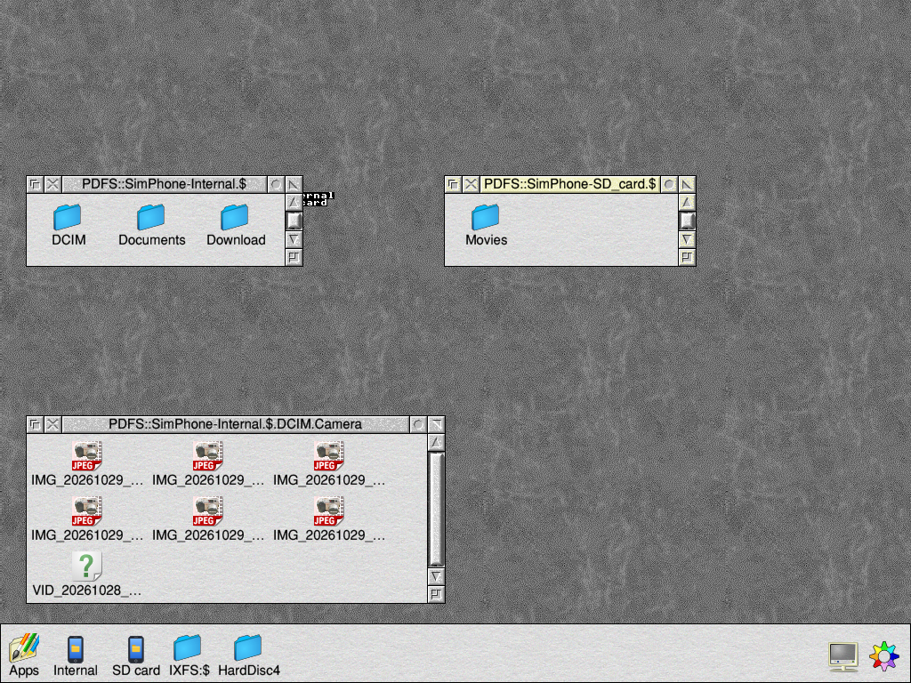
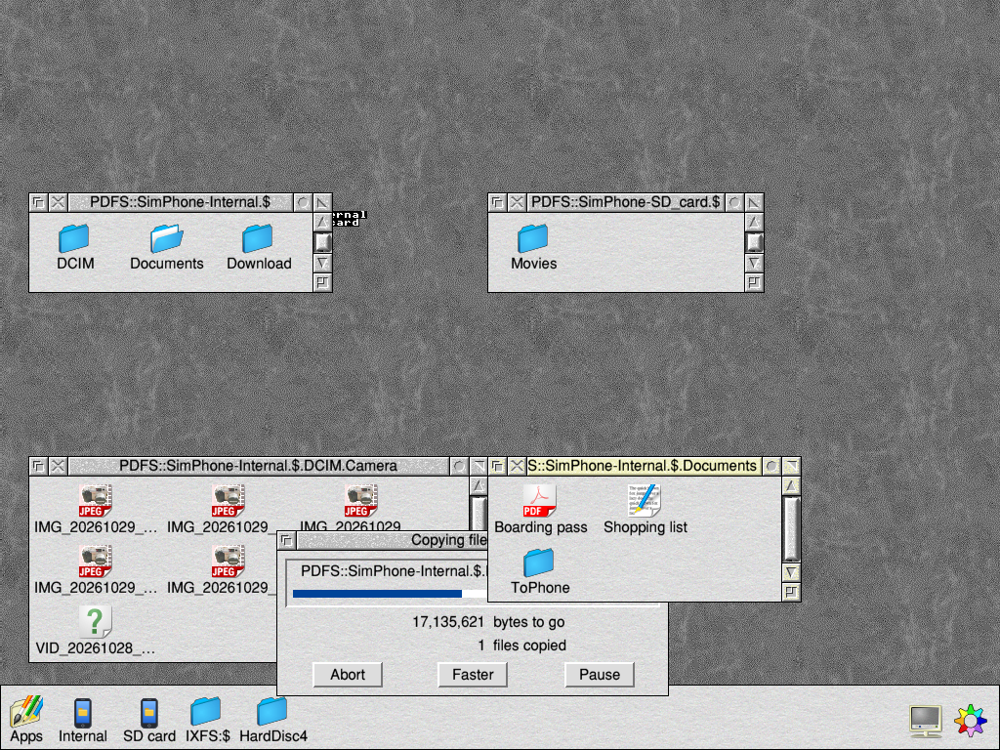
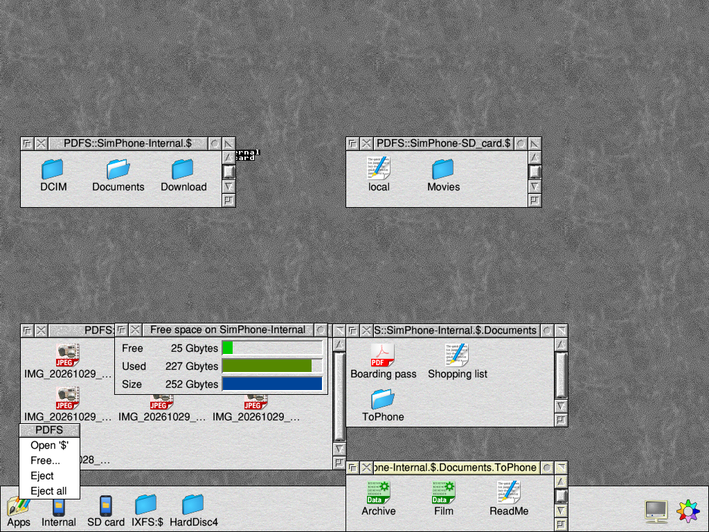

# PDFS: Portable Device Filing System

A RISC OS filing system module for phones, tablets, media players and cameras that use
MTP (Media Transfer Protocol). A connected device's storages show up as
discs, such as `PDFS::Pixel-Internal.$`, and work with the Filer, `*Copy`,
BASIC's OPENIN/OPENOUT and every program that uses FileSwitch.

Status: **0.16 beta.** It works with an Android phone (a Pixel) and an
Amazon Fire 7 tablet on a Raspberry Pi with RISC OS 5: browsing, copying
both ways with the Filer, big files, unplugging, switching the phone between
charging and file transfer, and Android's "Allow access" prompt. It's tested against a simulated device
too, over TCP and through an emulation of USBDriver and DeviceFS. Reports
from other devices (tablets, cameras, media players) and machines are
welcome: see docs/TESTING-ON-A-PI.md.

> **Use at your own risk.** PDFS is a beta. It's provided as it is, without
> warranty of any kind, and without liability for any loss or damage,
> including lost data, as the Apache License 2.0 says (sections 7 and 8).
> Only use it with devices whose data you have backed up, and keep copies
> of anything you copy to or from a device until you've checked it.

Licence: Apache 2.0 (see LICENSE). What it was written from (specifications,
RISC OS documentation and sources read): docs/REFERENCES.md.

## Screenshots

From riscos-linux-testbed (RISC OS 5 for Linux) with the simulated device
(`sim/mtpsim.py`), as the desktop test takes them.

| | |
|---|---|
|  |  |
| Filer_Action copying a folder to the device: its own window counts the bytes down as the device takes them | The icon's menu (Open, Free, Eject, Eject all) and the Free window |

## Installing

With PackMan: add the source https://adyoull.github.io/riscos-packages/pkg/index
and install **PDFS**. It goes in !Boot's PreDesk, so it's loaded at start-up.

Or unzip `PDFS-0.16-beta.zip` (from the GitHub release) and double-click
`PDFS` to load it, or put it in `!Boot.Choices.Boot.PreDesk`. RISC OS 5
with its USB stack is needed for devices on USB.

## Layout

| Path | What |
|---|---|
| `core/mtp.c` | MTP/PTP session layer: transactions, recovery (cancel, reset, reopen), UTF-16 strings |
| `core/fs.c` | the filing system: devices and storages as discs, directory cache, name and type translation, FileSwitch entry points (Open, GetBytes, PutBytes, Args, Close, File, Func) |
| `core/transport.h`, `core/plat.h` | what the core needs from the platform: a transport (USB later, TCP now) and memory, time, logging, MimeMap |
| `riscos/module.c`, `header.s` | the RISC OS module: header, veneers, *commands, TCP transport over the Internet module, MimeMap |
| `riscos/usb.c` | the USB transport: finds MTP interfaces (Service_USB), DeviceFS streams for the endpoints |
| `riscos/filer.c` | the icon bar filer: a drive icon for each storage, its menu, drag to copy, Free |
| `riscos/sendwin.c` | Filer_Action's window (its own template and messages), shown while files are sent in the background |
| `tools/mksprites.py` | draws the drive icon and makes the ResourceFS block |
| `host/host.c` | `pdfs-host`: the same core on Linux, driven from the command line, for tests |
| `sim/mtpsim.py` | a simulated MTP device over TCP; host folders are its storages |
| `tests/host_test.py` | 499 host tests against several kinds of simulated device |
| `tests/rol/` | tests in RISC OS for Linux (riscos-linux-testbed): CLI and desktop, over TCP or emulated USB (`usbemu.c`) |

## Building

Needs riscos-crossdev (`RCD_DIR`, default `../riscos-crossdev`; its
toolchain, `RISCOS_TOOLCHAIN`, default `$RCD_DIR/toolchain/env`), and gcc
and Python 3 for the host build and tests.

    make            # out/PDFS,ffa, out/PDFS-usbemu,ffa (for the tests) and out/pdfs-host
    make check      # host tests
    make dist       # out/PDFS-<version>-beta.zip, filetypes kept

Or in riscos-crossdev's container image:

    docker run --rm -v "$PWD":/src -w /src ghcr.io/adyoull/riscos-crossdev:1.8.2 make all check dist

## Building on GitHub

`.github/workflows/riscos-build.yml` builds, runs the host tests and keeps
the zip for every push and pull request, in riscos-crossdev's image (the
version in `.riscos-deps`). `riscos-deps-update.yml` checks each day for a
newer riscos-crossdev and opens a pull request when one builds.

## Using it

    *RMLoad PDFS

In the desktop, plug the device in and, on an Android device, set it to *File transfer* (Android) or
unlock it: a drive icon appears on the icon bar for each of its storages
("Internal", "SD card"). Click it to open it; drag files to it to copy them.
Its menu has Open '$', Free, **Eject** (that storage) and, when the device
has more than one storage, **Eject all**: each writes what's waiting, closes
the windows and removes the icons; when nothing of the device is left, its
session is closed and it says the device can be unplugged. Eject is refused
while files on it are open. Unplugging without ejecting removes the icons
too.

Outside the desktop:

| Command | What |
|---|---|
| `*PDFSMount` | mount every MTP device connected by USB |
| `*PDFSMount USB<n> [<interface>]` | mount that USB device (for ones that don't say they're MTP) |
| `*PDFSMount <a.b.c.d>:<port>` | connect to the simulator (testing) |
| `*PDFSDevices` | mounted devices and storages, with free space |
| `*PDFSUSB [control on\|off]` | connected USB devices' interfaces, and which are MTP |
| `*PDFSEject <disc> [all]` | eject a storage, or (all) the whole device, safely |
| `*PDFSDismount [<disc>]` | disconnect at once |
| `*PDFSExtensions [show\|hide]` | how names with a type extension are shown |
| `*PDFSLog [on\|off\|trace]` | the log; trace logs every FileSwitch call and MTP request (also to Reporter) |
| `*PDFSBackground [on\|off]` | send big new files in the background, after the program has written them (off) |

System variables, read when a device is mounted:

| Variable | What |
|---|---|
| `PDFS$Gap` | cs between an answer from an Android device and the next request (1 if unset; 0 for none) |
| `PDFS$Events` | `0`: leave the device's event pipe closed |

Paths are `PDFS::<Model>-<Storage>.$.…`, e.g. `PDFS::Pixel_7-Internal.$.DCIM`.

To try it without a device: `python3 sim/mtpsim.py --port 7015 "Internal=/some/folder"`
and `*PDFSMount 127.0.0.1:7015`.

## Tests in riscos-linux-testbed

    TB=../riscos-linux-testbed RCD_DIR=../riscos-crossdev tests/rol/run.sh
    TB=... RCD_DIR=... ROL_HARDDISC=.../HardDisc4 tests/rol/run.sh --desktop
    TB=... tests/rol/run.sh --usbemu [--old-usbdriver] [--desktop]
    TB=... ROL_HARDDISC=... tests/rol/run.sh --charging|--charging-only [--irisram]
    TB=... ROL_HARDDISC=... tests/rol/run.sh --allow=empty|denied|busy
    TB=... tests/rol/run.sh --usbemu --fire

Environment for these: `PDFS_SIM_FLAGS` (more simulator options, e.g.
`--android`), `PDFS_TRACE=1` (print a trace of the first listing),
`EMU_IN_HALT=N` (the Nth input transfer fails in the emulation) with
`EMU_IN_DROP=1` (the answer it held is lost), `ALLOW_RECONNECT=1` and
`ALLOW_SLOW=1` (a device that reconnects after Allow, and answers slowly).

`--usbemu` uses a test build whose USB transport talks to an emulation of
USBDriver and DeviceFS (tests/rol/usbemu.c): a fake MTP device, USB9, bridged to
the simulator, which then fails any data phase that would need a USB
zero-length packet (`--zlp-strict 512`).

The CLI test covers *Cat/*Ex/*Info, *CDir, *Copy both ways and between
storages, *Rename, BASIC OPENOUT/OPENUP/append, *Wipe, and free space.
The desktop test opens Filer windows on the simulated device, copies a folder to it
and a photo back with Filer_Action, saves 12 MB with one OS_File call, and
saves screenshots; it measures the longest pause in the desktop during each
(`PDFS_SIM_RATE=3000` makes the simulated device take 3 MB/s).

`--charging` plays a phone plugged in set to charging only and then switched
to file transfer, as on a Pi: it takes nothing in, drops off the bus,
Service_DeviceDead comes, and it's back as a new USB device. The emulation
counts what crashed or hung USBDriver on a Pi (a close that would wait for
ever, a close that frees a gone device's transfer, a synchronous request to
a gone device, calls after Service_DeviceDead), and the test checks none
happen, that the phone is then mounted, and that the desktop isn't held.
`--charging-only` never switches it; `--irisram` runs !IrisRAM copying Iris
to the RAM disc meanwhile, as at a Pi's boot (`IRIS_HARDDISC`: a HardDisc4
with !IrisRAM and an !Iris that fits a 128 MB RAM disc).

## Names and types

- A file's type is kept in its name on the device, as phones and computers
  expect: saving a Text file `Letter` makes `Letter.txt`; a type with no
  known extension gets RISC OS's `,xxx` (`Prog,ffb`). Extensions come from
  MimeMap (with a built-in table when MimeMap isn't there).
- RISC OS sees `Letter.txt` as `Letter`, type Text; `Letter/txt` finds it
  too. Names that would then clash (`a.txt` and `a.jpg`) are shown whole.
  `*PDFSExtensions show` shows every name whole.
- Setting a file's type renames it (`Letter.txt` to `Letter.jpg`); renaming
  keeps the extension.
- Otherwise: `.` and `/` swap, a space becomes a hard space (&A0), characters
  RISC OS reserves become `_`, and so does anything outside Latin-1.

## Big files

Files up to 4 GB (MTP's limit).

- **PDFS writes as other filing systems do.** A new file of 1 MB or more
  (Filer_Action and *Copy create it with its size, then write it from the
  start) goes to the device as it's written: each write takes as long as
  the device takes it, so Filer_Action's own window shows the whole copy,
  bytes to go counting down as the device gets them, and the desktop runs
  between its writes (Filer_Action sizes them to keep it going). Abort in
  that window stops the copy, and the part-sent file isn't left on the
  device. Smaller files go when they're closed.
- What's written is kept as well, because FileSwitch doesn't pass the
  writes quite in order (a 4K buffer it's filling can follow data beyond
  it): the file goes to the device as far as it has been written without a
  gap. It's kept in memory up to 4 MB; beyond that in a dynamic area, "PDFS
  transfer" (Task Manager shows it), while there's the memory (48 MB is
  always left free), and otherwise in a scrap file in
  `<Wimp$ScrapDir>.PDFS`. These go when the file is closed or its device
  goes; scrap files left by a crash are deleted the next time one is needed.
- While a file is being written, directory listings come from what PDFS
  already knows; other requests that need the device get "The device is
  busy receiving a file".
- As on any filing system, a program that saves a big file in one go waits
  till it's all there: Filer_Action does that for files that fit in its
  memory, and while it does, the desktop waits too (a few seconds for tens
  of megabytes over USB 2).
- `*PDFSBackground on` changes that: in the desktop, a new file of 1 MB or
  more is only kept as it's written and its close returns at once; PDFS's
  filer then sends it a piece at a time between other tasks' turns, in a
  copy window of its own (Filer_Action's window design, opened where
  Filer_Action's was once that has gone), with Abort and Pause. Up to 24
  files wait in turn; anything else that needs the device waits for them;
  quitting the desktop sends what's left first. Off by default.

## USB notes

The USB transport (riscos/usb.c) is the one from 0.03, which works on a
Raspberry Pi with an Android phone. Its use of DeviceFS follows RISC OS
Technologies' Bluetooth-RISCOS32 (BSD-2-Clause) findings:

- Devices come from Service_USB 1; endpoints are DeviceFS streams
  `devices#interface;alternate;endpoint;bulk;nopad;size`.
- Reads: WakeUpRX, then only what BufferSpace says is there, so nothing
  blocks inside DeviceFS.
- Writes: each piece into an empty buffer, then WakeUpTX; done when the
  buffer is empty and the transfer has finished.
- No zero-length packets: datasets get a padding byte, and a file whose
  data would be a whole number of packets goes as all but its last byte
  followed by an edit that adds it.
- Control requests aren't used (some USB drivers do them synchronously);
  `*PDFSUSB control on` allows MTP's Cancel request for testing.
- An input transfer that fails isn't restarted by USBDriver (every read is
  refused until ClearStall), and TransferInfo says only -1: PDFS checks it
  while waiting, logs the reason (MonitorRX's error), clears the pipe with
  ClearStall, and asks again for an answer that was lost.

(0.04-0.06 tried USBDriver's 'short' flag and pipelined writes, written to
ROOL's documentation; on the Pi they didn't work, so they were taken out.)

## Not done yet

- Testing with more real devices: phones, tablets, media players, cameras (docs/TESTING-ON-A-PI.md).
- SWIs (no SWI chunk yet). Filing system number &FA and error base &1FA00 are
  provisional until allocated by ROOL.
